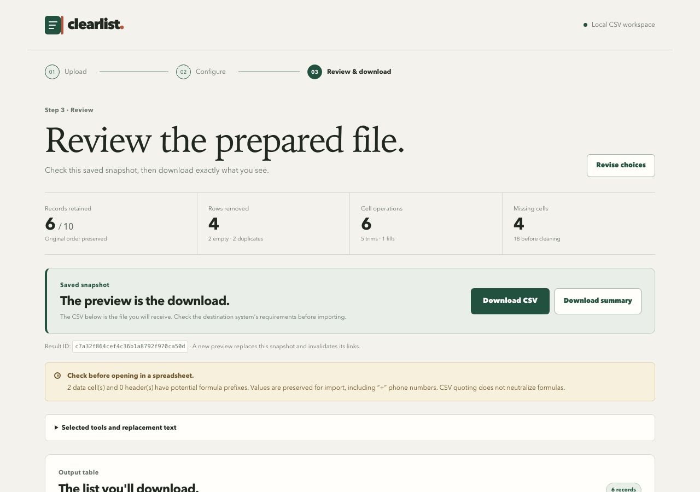
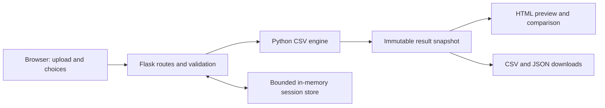

# Clearlist

A small Python application for small-business administrators preparing customer CSVs for a system import. Inspect missing values and exact duplicates, choose corrections, review the proposed changes, then download the exact CSV you previewed.

Built as a focused software engineering work sample. All bundled customer records are fictional. AI assisted development; the running application does not use AI, send CSVs to external services, or need API keys.



## Run with Docker

Prerequisite: a running Docker installation. The initial build downloads the base image and dependencies.

```sh
docker build -t csv-cleaner .
docker run --rm --read-only -p 127.0.0.1:8000:8000 \
  --tmpfs /tmp:rw,noexec,nosuid,size=64m csv-cleaner
```

Open [http://localhost:8000](http://localhost:8000). Stop with Ctrl+C. No volumes or configuration are required. Port 8000 is published only to your computer; change the left-hand port if it is already in use.

The application has four optional operations, all off for a new upload:

1. Remove fully empty rows.
2. Trim surrounding whitespace in selected columns.
3. Fill missing cells in selected columns with your own text.
4. Remove exact duplicate rows, retaining the first occurrence after the preceding operations.

The order is fixed. Empty rows are removed before replacements so they cannot become artificial customer records. Missing means `value.strip() == ""`; literal `NA`, `NULL`, and `0` are ordinary values. Matching is case-sensitive across every column. There is no fuzzy matching, type inference, or automatic phone/email normalization.

## Try the fictional example

Download the sample from the home page or use [samples/fictional_customers.csv](samples/fictional_customers.csv).

1. Upload it. The report should show **10 records, 6 columns, 18 missing cells, 2 fully empty rows, and 1 duplicate extra**.
2. Select both row-removal options. Select trim for `name`, `email`, and `city`.
3. Select fill missing for `city` and enter `Unknown`.
4. Preview. Expect **6 records**, **2 empty rows removed**, **2 duplicate rows removed**, **5 trims**, **1 fill**, and **4 remaining missing cells**.
5. Inspect the before/after cells and removed source numbers. The retained sources are **1, 2, 5, 6, 8, 9**. Notice that leading zeros, Chinese names, `NULL`, `NA`, a quoted comma, and an embedded newline survive.
6. Download `cleaned.csv` and `summary.json`. Both belong to the displayed result ID. The summary includes the CSV's SHA-256 for an independent file check.

Some fictional phone numbers start with `+`, so a conservative spreadsheet-formula warning is expected. Missing optional values remain unresolved: this tool prepares a file for further import checks, rather than certifying compatibility with an unspecified destination.

## Data contract and limitations

- One comma-separated UTF-8 `.csv`, optionally with a UTF-8 BOM and LF or CRLF record separators; the first record must contain unique, nonblank headers.
- Maximum **2 MiB input, 10,000 data records, 50 columns**, **100,000 characters per cell/header**, **200 characters per replacement**, and **10 MiB output**. Request/form limits also apply.
- Quoted commas, doubled quotes, embedded newlines, Unicode, header-only files, and blank records are supported. Blank records become fully empty records; they are not silently discarded.
- Invalid encoding, quoting, NULs, duplicate/blank headers, and inconsistent row widths are rejected. No guessing of delimiter or encoding. A one-column file is valid, so an unsupported delimiter cannot always be distinguished from ordinary text; inspect the column preview.
- All values remain strings. Headers, retained-record order, and column order are preserved. No generated index is exported. Source numbers refer to data records, not physical file lines.
- Output uses UTF-8 without an added BOM, comma separation, standard quoting, and CRLF record separators. Embedded newline values are retained. Formatting need not be byte-identical to the original.
- The original bytes/table are immutable. Changing options always starts from the original, never from a previously cleaned result.
- Preview data is parsed from the saved CSV bytes. Downloads serve the saved bytes, without rerunning cleaning. A new preview, replacement upload, reset, expiry, or restart invalidates old links instead of silently returning another result.
- Cell-operation counts describe sequential effects, including changes to rows subsequently removed. They are not counts of unique final cells changed.
- Excel files, batch processing, destination schemas, inferred corrections, persistent histories, accounts, and hosted/multi-worker deployment are deliberately deferred.

### Privacy and spreadsheet precautions

Data lives in a bounded, server-side memory store, separate for each browser session. The local deployment supports four active sessions and a 30-minute idle expiry. Expired entries are pruned on requests; a reset, replacement upload, or process restart clears associated state. Closing a tab alone does not immediately clear it. Cookies contain only random session/form identifiers, not customer rows. The Docker command places temporary request files in memory and makes the remaining filesystem read-only. No customer contents are logged by the application.

Potential formula prefixes are flagged in headers and data, including replacement values. Values are **preserved**, including `+` phone numbers; quoting is not formula neutralization. Opening untrusted CSVs in spreadsheet software may interpret them as formulas. This export prioritizes import-value preservation, and does not claim a universally safe spreadsheet export. See [OWASP's explanation](https://owasp.org/www-community/attacks/CSV_Injection).

## Design



- **Flask + Jinja + local CSS:** conventional form requests and server-rendered pages; no JavaScript framework or external assets.
- **Standard-library CSV engine:** explicit string handling avoids unintended identifier or missing-token conversion; transformations are independently testable.
- **Snapshot storage:** one upload and latest result per session. Downloads require the owning session and result ID. No-store response headers, template escaping, form protection, and fixed attachment names protect the workflow.
- **One Gunicorn worker:** intentional because state is process-local. Scaling to multiple workers would require shared storage and a different lifecycle design. Restarting invalidates sessions; this is acceptable for a temporary local work sample.
- **Docker:** pinned Python 3.12 image digest, exact runtime/test dependency versions, non-root user, a health check, and separate test/runtime build targets.

The main code is in `src/csv_cleaner`: `engine.py` handles parsing/reporting/cleaning, `web.py` handles the browser workflow, and `state.py` owns temporary state. There is no database or separately supported REST API.

## Verify

```sh
docker build --target test -t csv-cleaner-test .
docker run --rm --read-only --tmpfs /tmp:rw,noexec,nosuid,size=64m csv-cleaner-test
```

This runs Ruff checks and pytest. Tests use independently specified expected values and cover transformations, preservation, malformed input, output expansion, snapshot/download identity, session ownership, expiry/reset/replacement, pagination, form protection, and escaped HTML. The GitHub workflow runs those checks and a runtime health smoke test. The [initial implementation check passed](https://github.com/JeffYYH/clearlist/actions/runs/41126340381); check the Actions page for subsequent runs.

For a running container, `GET /healthz` should return `{"status":"ok"}`. Follow the sample walkthrough above to inspect the actual browser layout and downloaded files. Automated checks do not replace that visual review.

Desktop and [mobile](docs/screenshots/preview-mobile.jpg) review screenshots are included. The latest observed local verification completed **71 tests**, Ruff checks, a healthy non-root container with a read-only filesystem, and the browser sample workflow. Downloaded CSV and summary hashes/identities were also checked.

See [the AI-assisted workflow record](docs/ai-workflow.md) for decisions, observed checks, time accounting, and remaining submission steps.
